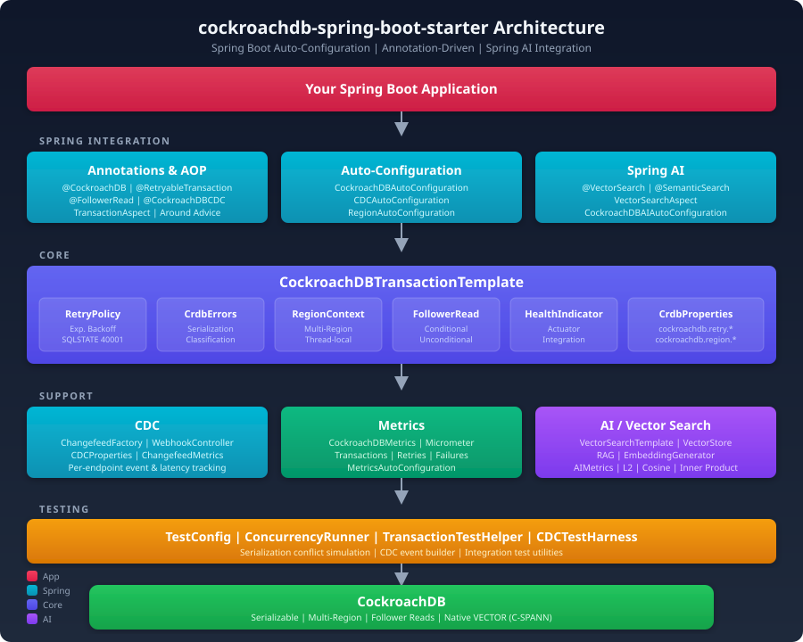

# CockroachDB Spring Boot Starter

[](https://github.com/cockroachlabs/cockroachdb-spring-boot-starter/actions/workflows/ci.yml)
[](https://github.com/cockroachlabs/cockroachdb-spring-boot-starter/releases)
[](LICENSE)

A Spring Boot starter that provides automatic retry handling for CockroachDB serialization errors (SQLSTATE `40001`), built-in transaction metrics, multi-region support for REGIONAL BY ROW tables, concurrency testing utilities, and Spring AI `VectorStore` integration for RAG pipelines.

Designed for Spring Boot 4.x and Java 17+. **GraalVM Native Image ready.**

Building from source requires GraalVM 25; Gradle downloads it automatically if missing. The published jar targets Java 17 bytecode.

## Architecture



See [docs/architecture.md](docs/architecture.md) for the starter's design philosophy (it follows Spring conventions and extends them to support CockroachDB), how the repository is organized, and its internals. [docs/guides.md](docs/guides.md) has the rules behind the executable getting-started guides.

## Getting-started guides

Short, executable tutorials, each one focused on a single feature and sized to finish in 30 to 60 minutes:

- [Retrying serialization conflicts in `@Transactional` code](guides/serialization-retry/README.md)

See [guides/README.md](guides/README.md) for how to follow a guide and how to write a new one.

## Features

- **Transaction retries** — `@Transactional` methods are retried on serialization conflicts (SQLSTATE `40001`) with exponential backoff; `@CockroachDBTransactional` is `@Transactional` plus per-method retry settings
- **`CockroachDBTransactionTemplate`** — A `TransactionTemplate` that retries serialization conflicts
- **Multi-region support** — `RegionContext`, `RegionResolver`, `inRegion()` for REGIONAL BY ROW tables
- **JPA annotations** — `@RegionalByRow`, `@CrdbRegion`, `@GlobalTable` for entity-level region handling, checked against the live schema at startup (`cockroachdb.multiregion.mode`, `warn` by default)
- **Micrometer metrics** — Transaction count, retries, failures, and duration (auto-enabled with Actuator)
- **Concurrency runner** — `CockroachDBConcurrencyRunner` for stress-testing serialization behavior
- **CDC webhook handlers** — `@CockroachDBCDC` annotation for consuming CockroachDB changefeeds via HTTP webhook sink
- **CDC test harness** — `CDCTestHarness` and `CDCEventBuilder` for integration testing without a live changefeed
- **CDC metrics** — Per-endpoint event counts, latency, and auth failure tracking (auto-enabled with Actuator)
- **Follower reads** — `@FollowerRead` annotation for low-latency historical reads from the nearest replica, at `follower_read_timestamp()` or a chosen time in the past
- **Vector search** — `@VectorSearch` annotation for pgvector-compatible similarity search (L2, cosine, inner product) with CockroachDB's C-SPANN distributed vector indexing
- **Semantic search** — `@SemanticSearch` annotation for RAG-style queries combining vector similarity with structured SQL filters in a single transaction
- **`VectorSearchTemplate`** — Programmatic API for embedding storage, similarity search, and hybrid queries (vector + relational filters)
- **Spring AI `VectorStore`** — `CockroachDBVectorStore` implementing Spring AI's `VectorStore` for seamless RAG with `ChatClient` and `QuestionAnswerAdvisor`
- **AI metrics** — Vector search count, latency, and result-set tracking (auto-enabled with Actuator)
- **Null safety** — The API is null-marked with [JSpecify](https://jspecify.dev/), as Spring Framework 7 is (see [Null Safety](#null-safety))

## Installation

Artifacts are served from this repository's **GitHub Pages Maven repository** — no token required.

### Gradle

```groovy
repositories {
    mavenCentral()
    maven { url 'https://cockroachlabs.github.io/cockroachdb-spring-boot-starter/maven/' }
}

dependencies {
    implementation 'com.cockroachlabs:cockroachdb-spring-boot-starter:0.7.0'
}
```

### Maven

```xml
<repositories>
  <repository>
    <id>cockroachlabs</id>
    <url>https://cockroachlabs.github.io/cockroachdb-spring-boot-starter/maven/</url>
  </repository>
</repositories>

<dependency>
    <groupId>com.cockroachlabs</groupId>
    <artifactId>cockroachdb-spring-boot-starter</artifactId>
    <version>0.7.0</version>
</dependency>
```

API reference: https://cockroachlabs.github.io/cockroachdb-spring-boot-starter/

## Configuration

Add to `application.yml`:

```yaml
cockroachdb:
  retry:
    max-retries: 3        # Max retry attempts for 40001 errors
    delay: 100            # Initial delay in ms
    multiplier: 2.0       # Exponential backoff multiplier
    max-delay: 5000       # Max delay cap in ms
    jitter: 50            # Randomized jitter in ms
    apply-to-transactional-methods: true  # Also retry plain @Transactional methods
  region:
    default-region: ""    # Default region (empty = gateway region)
    validate: false       # Validate against allowed list
    allowed: []           # Allowed regions (empty = allow any)
    resolver: context     # Strategy: static | header | context | bean
    header-name: X-CockroachDB-Region
  metrics:
    enabled: true         # Enable transaction metrics
  multiregion:
    mode: warn            # Startup check of @GlobalTable/@RegionalByRow: none | warn | validate
```

## Usage

### 1. Transaction retries: `@Transactional` and `@CockroachDBTransactional`

CockroachDB runs transactions at SERIALIZABLE isolation. When concurrent transactions conflict, it aborts one of them with SQLSTATE `40001`, which means "run this transaction again from the beginning". The starter does that for you: a transactional method that fails with `40001` is rolled back and run again in a **fresh transaction**, after a short wait that grows with each attempt (exponential backoff with jitter).

**Plain `@Transactional` methods are retried automatically.** With the starter on the classpath, every method Spring treats as transactional gets these retries, with the `cockroachdb.retry.*` defaults: `@Transactional` on a method, a class or an interface, composed annotations, and `jakarta.transaction.Transactional`. Existing code needs no changes. To turn this off and retry only `@CockroachDBTransactional` methods, set `cockroachdb.retry.apply-to-transactional-methods=false`.

```java
@Service
public class AccountService {

    private final AccountRepository accountRepo;

    public AccountService(AccountRepository accountRepo) {
        this.accountRepo = accountRepo;
    }

    @Transactional   // retried on 40001 with the cockroachdb.retry.* defaults
    public void transfer(UUID from, UUID to, BigDecimal amount) {
        Account sender = accountRepo.findById(from).orElseThrow();
        Account receiver = accountRepo.findById(to).orElseThrow();
        sender.debit(amount);
        receiver.credit(amount);
        accountRepo.saveAll(List.of(sender, receiver));
    }
}
```

**`@CockroachDBTransactional` is `@Transactional` with retry settings.** It is a composed annotation, meta-annotated with `@Transactional`, so Spring's own transaction support runs the transaction and every `@Transactional` attribute (`value`/`transactionManager`, `label`, `propagation`, `isolation`, `timeout`/`timeoutString`, `readOnly`, `rollbackFor`, `noRollbackFor` and their `ClassName` forms) means exactly what it does there. The one difference is that `isolation` defaults to **SERIALIZABLE**, CockroachDB's default level. On top of those it adds:

| Attribute | Default | Meaning |
|-----------|---------|---------|
| `maxRetries` | `cockroachdb.retry.max-retries` | Retries after a `40001` before giving up |
| `delay` | `cockroachdb.retry.delay` | Milliseconds before the first retry |
| `multiplier` | `cockroachdb.retry.multiplier` | Factor applied to the delay after each retry |
| `maxDelay` | `cockroachdb.retry.max-delay` | Longest wait between retries, in milliseconds |
| `region` | resolved per transaction | Session region for REGIONAL BY ROW tables (see [Multi-Region Support](#3-multi-region-support)) |

Use it where a method needs different retry settings, a fixed region, or retries even when `apply-to-transactional-methods` is off:

```java
// A hot method under heavy contention gets more retries than the default.
@CockroachDBTransactional(maxRetries = 10, delay = 50)
public void transfer(UUID from, UUID to, BigDecimal amount) { ... }

// Every @Transactional attribute works as usual.
@CockroachDBTransactional(readOnly = true, timeout = 5)
public BigDecimal totalBalance() { ... }
```

Like `@Transactional`, it can go on a class, where it applies to every public method; an annotation on the method wins. Use one or the other on a method, not both.

How the retries behave, for both annotations:

- **Only `40001` is retried.** An attempt is retried when any exception in its cause chain is a `SQLException` with SQLSTATE `40001`, whatever wraps it: plain JDBC (`CannotAcquireLockException`) and JPA/Hibernate (`JpaSystemException`, or `TransactionSystemException` when the commit fails) alike. Any other exception is rethrown immediately, with `@Transactional`'s usual commit or rollback.
- **Only the outermost transactional call retries.** A transactional method called inside a transaction that is already running runs once. If it hits a `40001`, the exception propagates to the method that started the transaction, which retries the whole unit of work. Retrying the inner call alone would be pointless, because CockroachDB has already aborted the transaction it belongs to.
- **Every attempt runs the whole method again**, so keep side effects outside the database (sending email, calling other services) out of transactional methods, or make them idempotent.

The same rules apply to `CockroachDBTransactionTemplate`.

### 2. `CockroachDBTransactionTemplate`

For programmatic control, use `CockroachDBTransactionTemplate`. It **is** a Spring `TransactionTemplate` (it extends it), so you use it the same way: the same `execute(TransactionCallback)` and `executeWithoutResult(Consumer<TransactionStatus>)` methods, the same setters (`setIsolationLevel`, `setPropagationBehavior`, `setReadOnly`, `setTimeout`, ...), and it can be injected anywhere a `TransactionOperations` is expected. The difference is that the callback is retried in a fresh transaction on a `40001`, and the isolation level defaults to SERIALIZABLE. Like the annotations, it retries only when it starts the transaction: called inside a transaction that is already running, it runs the callback once.

The starter registers one, configured from `cockroachdb.retry.*`:

```java
@Service
public class AccountService {

    private final CockroachDBTransactionTemplate tx;
    private final AccountRepository accountRepo;

    public AccountService(CockroachDBTransactionTemplate tx, AccountRepository accountRepo) {
        this.tx = tx;
        this.accountRepo = accountRepo;
    }

    public void transfer(UUID from, UUID to, BigDecimal amount) {
        tx.executeWithoutResult(status -> {
            Account sender = accountRepo.findById(from).orElseThrow();
            Account receiver = accountRepo.findById(to).orElseThrow();
            sender.debit(amount);
            receiver.credit(amount);
            accountRepo.saveAll(List.of(sender, receiver));
        });
    }
}
```

When the callback doesn't need the `TransactionStatus`, `execute(Supplier)` and `executeWithoutResult(Runnable)` overloads let you drop the parameter: `tx.execute(() -> accountRepo.sumAllBalances())`.

Like `TransactionTemplate` and `TransactionOperations`, the template's operations are also declared by an interface, `CockroachDBTransactionOperations`, which extends `TransactionOperations` and adds those overloads and `inRegion(...)`. Inject the interface where code only runs transactions and has no business changing the template's settings:

```java
public AccountService(CockroachDBTransactionOperations tx, AccountRepository accountRepo) { ... }
```

To use different settings, do what you would with `TransactionTemplate`: create a configured instance once and reuse it. The copy constructor starts from the shared template's settings:

```java
public AccountService(CockroachDBTransactionTemplate shared, AccountRepository accountRepo) {
    this.reports = new CockroachDBTransactionTemplate(shared);
    this.reports.setIsolationLevel(TransactionDefinition.ISOLATION_READ_COMMITTED);
    this.reports.setReadOnly(true);
    this.reports.setMaxRetries(10);   // retry settings: setMaxRetries, setDelay, setMultiplier, setMaxDelay
    this.accountRepo = accountRepo;
}
```

As with `TransactionTemplate`, configure an instance before sharing it between threads, and don't change the shared bean's settings at runtime.

### 3. Multi-Region Support

The starter runs `SET crdb_region = '...'` at the start of every transaction begun by a `@Transactional` method, a `@CockroachDBTransactional` method or `CockroachDBTransactionTemplate`, using the region resolution chain below. With no region from any source, it runs nothing and CockroachDB uses the gateway node's region.

#### Set region via `@CockroachDBTransactional`

```java
@CockroachDBTransactional(region = "us-east1")
public void createOrderEast(Order order) {
    orderRepo.save(order);
}
```

#### Set region programmatically with `inRegion()`

`inRegion(region)` returns a copy of the template that sets the region; the original is unchanged. For a fixed region, `setRegion(region)` on your own configured instance does the same.

```java
public void createOrder(String region, Order order) {
    tx.inRegion(region).executeWithoutResult(status -> orderRepo.save(order));
}
```

#### Set region per-request with `RegionContext`

```java
// In a filter, interceptor, or manually:
RegionContext.set("eu-west1");

// Transactions begun in this thread by @Transactional, @CockroachDBTransactional and
// CockroachDBTransactionTemplate will use eu-west1 until cleared.

// Scoped (auto-cleanup):
try (var scope = RegionContext.scoped("eu-west1")) {
    tx.execute(() -> orderRepo.save(order));
}
```

#### Auto-detect region from HTTP headers

Configure the header-based resolver:

```yaml
cockroachdb:
  region:
    resolver: header
    header-name: X-CockroachDB-Region
```

Then clients send:

```
POST /api/orders
X-CockroachDB-Region: us-west1
```

#### Custom `RegionResolver`

Implement your own strategy (GeoIP, config service, etc.):

```java
@Bean
public RegionResolver regionResolver(GeoIPService geoIP) {
    return () -> {
        HttpServletRequest req = ((ServletRequestAttributes)
            RequestContextHolder.getRequestAttributes()).getRequest();
        return geoIP.regionForIp(req.getRemoteAddr());
    };
}
```

Set `resolver: bean` in config so the starter doesn't override your bean.

#### Region resolution priority

When multiple sources provide a region, the highest-priority source wins:

| Priority | Source | Example |
|----------|--------|---------|
| 1 | `@CockroachDBTransactional(region = "...")` or the template's `setRegion` / `inRegion` | Explicit per method or template |
| 2 | `RegionContext.current()` | ThreadLocal (filter, scoped) |
| 3 | `RegionResolver` bean | Header, GeoIP, custom |
| 4 | `cockroachdb.region.default-region` | `application.yml` |
| 5 | *(empty)* | CockroachDB uses gateway node's region |

### 4. JPA Entity Annotations

Three annotations say where an entity's rows live in a multi-region database:

| Annotation | Goes on | The table must be | Use it for |
|------------|---------|-------------------|------------|
| `@GlobalTable` | the entity class | `GLOBAL` | Reference data that every region reads and few write: currencies, countries, feature flags. Reads are fast in every region; writes take longer. |
| `@RegionalByRow` | the entity class | `REGIONAL BY ROW` | Data that belongs to a user, tenant or place. Each row is stored in its home region, so reads and writes from there are fast. |
| `@CrdbRegion` | a `String` field of a `@RegionalByRow` entity | the table's region column | The row's home region. |

An entity with neither annotation maps to an ordinary table, which in a multi-region database is `REGIONAL BY TABLE` and lives in the primary region.

The annotations don't create or change tables. Your migrations (Flyway or Liquibase) do that, and the [startup check](#checking-tables-against-the-annotations) confirms that the tables and the annotations agree. Setting it up takes four steps.

#### Step 1: give the cluster regions

Start every node with a region in its locality, for example `cockroach start --locality=region=us-east1,zone=us-east1-b ...`. CockroachDB Cloud multi-region clusters already have them. `SHOW REGIONS FROM CLUSTER` lists the regions the cluster has.

To try this on a laptop, `cockroach demo --global --nodes 9` simulates three regions, and [`examples/ideas-board/multiregion-compose.yml`](examples/ideas-board/multiregion-compose.yml) runs a three-region cluster in Docker.

#### Step 2: make the database multi-region

In a migration, choose the primary region and add the others. Region names must be ones the cluster has:

```sql
ALTER DATABASE app SET PRIMARY REGION "us-east1";
ALTER DATABASE app ADD REGION "us-west1";
ALTER DATABASE app ADD REGION "eu-west1";
```

The primary region is where tables without a locality live, and the home of rows that don't name one. Only the database's regions are valid home regions for rows.

#### Step 3: create the tables with their locality

```sql
-- @GlobalTable
CREATE TABLE currencies (
    code STRING PRIMARY KEY,
    name STRING NOT NULL
) LOCALITY GLOBAL;

-- @RegionalByRow, region in the hidden crdb_region column
CREATE TABLE orders (
    id            UUID PRIMARY KEY DEFAULT gen_random_uuid(),
    customer_name STRING NOT NULL,
    total         DECIMAL(12,2) NOT NULL
) LOCALITY REGIONAL BY ROW;

-- @RegionalByRow, region in a column of your own
CREATE TABLE customers (
    id          UUID PRIMARY KEY DEFAULT gen_random_uuid(),
    name        STRING NOT NULL,
    home_region crdb_internal_region NOT NULL
                DEFAULT default_to_database_primary_region(gateway_region())::crdb_internal_region
) LOCALITY REGIONAL BY ROW AS home_region;
```

`LOCALITY REGIONAL BY ROW` adds a hidden column, `crdb_region crdb_internal_region NOT VISIBLE NOT NULL`, which defaults to the region of the node that ran the insert. `REGIONAL BY ROW AS <column>` uses your column instead; it must be of type `crdb_internal_region`.

For a table that already exists, use `ALTER TABLE currencies SET LOCALITY GLOBAL;` or `ALTER TABLE orders SET LOCALITY REGIONAL BY ROW;`. Changing a table to `REGIONAL BY ROW` rewrites it, so schedule that migration.

#### Step 4: annotate the entities

```java
@Entity
@Table(name = "currencies")
@GlobalTable
public class Currency {

    @Id
    private String code;

    private String name;
}
```

```java
@Entity
@Table(name = "orders")
@RegionalByRow(defaultRegion = "us-east1")
@EntityListeners(RegionalByRowListener.class)
public class Order {

    @Id
    @GeneratedValue
    private UUID id;

    @CrdbRegion
    @Column(name = "crdb_region", columnDefinition = "crdb_internal_region")
    private String region;

    private String customerName;

    private BigDecimal total;
}
```

For the `customers` table, map the `@CrdbRegion` field to `home_region` instead: `@Column(name = "home_region")`. The `columnDefinition` only matters if Hibernate generates the schema; with migrations it can be left out.

Imports: the annotations are in `com.cockroachlabs.data.annotation`, and `RegionalByRowListener` is in `com.cockroachlabs.data.multiregion`.

#### How a row gets its region

When a `@RegionalByRow` entity is persisted, `RegionalByRowListener` fills an empty `@CrdbRegion` field with the first of:

1. the transaction's region, from `@CockroachDBTransactional(region = ...)`, `inRegion(...)`, `RegionContext`, a `RegionResolver` or `cockroachdb.region.default-region` ([section 3](#3-multi-region-support));
2. the entity's `@RegionalByRow(defaultRegion = ...)`.

A region you set on the field yourself is kept.

```java
@CockroachDBTransactional(region = "eu-west1")
public Order placeOrder(Order order) {
    return orders.save(order);   // order.region is empty, so the row is stored in eu-west1
}
```

Things to know:

- **Register the listener.** Without `@EntityListeners(RegionalByRowListener.class)`, nothing fills the field.
- **A row needs a region.** If none is found, Hibernate inserts `NULL` and CockroachDB rejects the row: `null value in column "crdb_region" violates not-null constraint`. Set `defaultRegion`, or `cockroachdb.region.default-region`. Alternatively, `@DynamicInsert` on the entity leaves the column out of the insert, so its default (the node's region) applies.
- **The region must be one of the database's.** Anything else fails with `invalid input value for enum crdb_internal_region`.
- **Persist only.** The listener sets the region when a row is created. To move an existing row to another region, change the field and save it.
- **Annotate the entity class itself.** The listener reads `@RegionalByRow` and `@CrdbRegion` from the entity's own class, not its superclasses. (The startup check does look at superclasses.)

#### Checking tables against the annotations

On their own, `@GlobalTable` and `@RegionalByRow` don't change the schema, so a migration that forgot `ALTER TABLE ... SET LOCALITY`, or a database that was never made multi-region, goes unnoticed. At startup, after Flyway or Liquibase have run, the starter compares every entity with the live database in both directions: annotated entities must match their tables, and `GLOBAL` or `REGIONAL BY ROW` tables must have annotated entities:

| Mode | Behavior |
|------|----------|
| `none` | No check |
| `warn` (default) | Log any problems, with SQL that fixes them, and continue startup. A contradiction (below) still fails startup |
| `validate` | Fail startup on any problem, with SQL that fixes it |

Most problems are gaps: a migration that hasn't set the locality yet, a database that isn't multi-region yet, or an annotation that's missing. A **contradiction** is different: the annotations and the schema disagree about where rows live, so one of them is wrong. Contradictions fail startup in `warn` as well as `validate`, and are marked `Contradiction:` in the report:

- `@GlobalTable` on a `REGIONAL BY ROW` table, or `@RegionalByRow` on a `GLOBAL` table.
- An entity annotated with both `@GlobalTable` and `@RegionalByRow`, or entities mapped to the same table with different annotations.

Only `none` lets an application start with a contradiction.

The values follow `spring.jpa.hibernate.ddl-auto`, but there is no `update`: the check only reads, and never changes the schema. Your migration tool stays in charge of it.

The check runs only with Hibernate and only against CockroachDB: if your tests use another database, it skips quietly. Set `cockroachdb.multiregion.mode` to `validate` to make problems fail startup (for example in CI), or to `none` to turn the check off.

It checks, in order:

1. **The database.** If it isn't multi-region, that is reported once rather than for every entity. When the cluster's nodes have regions, the report suggests `ALTER DATABASE ... SET PRIMARY REGION` and `ADD REGION` for them; when they don't (nodes started without `--locality=region=...`), it says so.
2. **Each annotated entity's table.** A `@GlobalTable` table must be `GLOBAL`. A `@RegionalByRow` table must be `REGIONAL BY ROW`; when the entity has a `@CrdbRegion` field, the table must be regional by that field's column, which must be of type `crdb_internal_region`. A missing table is reported too.
3. **Every other entity's table.** An entity without either annotation whose table is `GLOBAL` or `REGIONAL BY ROW` is reported, with the annotation to add. A table mapped by entities with conflicting annotations is reported too.

Annotations are found on the entity class or any superclass, so a subclass in a single-table hierarchy shares its parent's annotation.

Table and column names come from Hibernate's metamodel, so a custom `PhysicalNamingStrategy` or quoted names work as they do for your queries. The check needs Hibernate and runs for every `EntityManagerFactory`.

Every problem is listed in one report, with the suggested SQL in one block to review and add to a migration. Problems with the annotations themselves get no SQL; the report names the annotation to add or fix:

```
CockroachDB multiregion check (com.cockroachlabs.data.multiregion.MultiregionCheck, cockroachdb.multiregion.mode=warn) found 1 problem:
  - Database app is not multi-region; @GlobalTable/@RegionalByRow on 2 entities (com.example.Currency, com.example.Order) have no effect.
    The cluster has regions: us-east1, us-west1. Choose the primary region deliberately; the SQL below uses the first one.

Suggested SQL (review, then add to a migration; or alter the annotations):
  ALTER DATABASE app SET PRIMARY REGION "us-east1";
  ALTER DATABASE app ADD REGION "us-west1";
  ALTER TABLE public.currencies SET LOCALITY GLOBAL;
  ALTER TABLE public.orders SET LOCALITY REGIONAL BY ROW;  -- rewrites the table

See also: https://docs.cockroachlabs.com/docs/stable/multiregion-overview
```

Changing a table to `REGIONAL BY ROW` rewrites it, so schedule that migration accordingly.

### 5. Metrics

When Spring Boot Actuator is on the classpath, the starter auto-registers Micrometer metrics:

| Metric | Type | Description |
|--------|------|-------------|
| `cockroachdb.transactions` | Counter | Total transactions attempted |
| `cockroachdb.transactions.success` | Counter | Successful transactions |
| `cockroachdb.transactions.failure` | Counter | Failed transactions (retries exhausted, or any other exception) |
| `cockroachdb.transactions.retries` | Counter | Retry attempts (40001) |
| `cockroachdb.transactions.duration` | Timer | Transaction duration |

Without Actuator, an in-memory fallback tracks the same counters (accessible via `CockroachDBMetrics` bean).

Expose via Prometheus:

```yaml
# build.gradle
runtimeOnly 'io.micrometer:micrometer-registry-prometheus'

# application.yml
management:
  endpoints:
    web:
      exposure:
        include: prometheus
```

### 6. Concurrency Testing

Use `CockroachDBConcurrencyRunner` to stress-test serialization behavior:

```java
@SpringBootTest
class TransferConcurrencyTest {

    @Autowired
    private AccountService accountService;

    @Test
    void concurrentTransfers() {
        CockroachDBConcurrencyRunner.Result result =
            CockroachDBConcurrencyRunner.run(
                10,    // threads
                100,   // iterations per thread
                () -> accountService.transfer(
                    accountA, accountB, BigDecimal.ONE)
            );

        System.out.println("Ops/sec: " + result.opsPerSecond());
        System.out.println("Successes: " + result.successes());
        System.out.println("Failures: " + result.failures());
        assertEquals(0, result.failures());
    }
}
```

### 7. CDC Webhook Handlers

CockroachDB [changefeeds](https://www.cockroachlabs.com/docs/stable/changefeed-sinks.html#webhook-sink) can push row-level changes to your application via HTTP webhook sink. The starter turns any Spring bean method into a CDC handler with the `@CockroachDBCDC` annotation.

#### Enable CDC

```yaml
cockroachdb:
  cdc:
    enabled: true
    base-path: /cdc          # Prefix for all webhook endpoints (default: /cdc)
    auth-token: ""            # If set, webhook requests must include this token
    auth-header: Authorization  # Header name for the token (default: Authorization)
    factory:
      enabled: true           # Auto-register CockroachDBCDCFactory bean (requires spring-jdbc)
```

#### Define a handler

Annotate a method with `@CockroachDBCDC` and declare the endpoint path. The method receives a `CDCEvent<T>` where `T` is your entity/DTO type:

```java
@Component
public class OrderCDCListener {

    @CockroachDBCDC(endpoint = "/orders")
    public void onOrderChange(CDCEvent<Order> event) {
        switch (event.operation()) {
            case INSERT -> handleNewOrder(event.after());
            case UPDATE -> handleOrderUpdate(event.before(), event.after());
            case DELETE -> handleOrderCancelled(event.key());
        }
    }

    // Filter by operation type and specify column projections
    @CockroachDBCDC(
        endpoint = "/orders/status",
        operations = CDCOperationType.UPDATE,
        projections = {"id", "status"}
    )
    public void onStatusChange(CDCEvent<OrderStatus> event) {
        log.info("Order {} status: {} -> {}",
                event.after().id(), event.before().status(), event.after().status());
    }
}
```

The handler is registered at `{basePath}{endpoint}` — e.g., `/cdc/orders`. Configure your CockroachDB changefeed to push to that URL:

```sql
CREATE CHANGEFEED FOR TABLE orders
  INTO 'webhook-https://your-app:9090/cdc/orders?insecure_tls_skip_verify=true'
  WITH updated, diff, resolved = '10s',
       webhook_sink_config = '{"Flush": {"Messages": 100, "Frequency": "1s"}}';
```

#### Handler signature options

| Parameter type | Behavior |
|---------------|----------|
| `CDCEvent<T>` | Called once per row change with typed before/after, key, operation, timestamp |
| `List<CDCEvent<T>>` | Called once per batch with all events in the webhook payload |
| `CDCEnvelope` | Raw envelope — for custom parsing or forwarding |
| `T` (entity) | Called with just the `after` entity (simplified handler) |

#### CDC metrics

When Actuator is on the classpath, the starter tracks per-endpoint CDC metrics:

| Metric | Type | Tags | Description |
|--------|------|------|-------------|
| `cockroachdb.cdc.events` | Counter | endpoint, operation, success | Events processed |
| `cockroachdb.cdc.events.duration` | Timer | endpoint, operation | Processing latency |
| `cockroachdb.cdc.webhooks.received` | Counter | endpoint | Raw webhook requests received |
| `cockroachdb.cdc.auth.failures` | Counter | endpoint | Authentication failures |
| `cockroachdb.cdc.resolved` | Counter | endpoint | Resolved timestamp markers |

#### Testing CDC handlers

Use `CDCTestHarness` to invoke handlers directly without HTTP or a live changefeed:

```java
@SpringBootTest
class OrderCDCTest {

    @Autowired
    private CDCTestHarness cdcTestHarness;

    @Autowired
    private OrderCDCListener listener;

    @Test
    void shouldHandleInsert() {
        Order order = new Order(UUID.randomUUID(), "PENDING", BigDecimal.TEN);
        cdcTestHarness.simulateInsert("/orders", order, order.getId());

        // Assert side effects in listener
    }

    @Test
    void shouldHandleUpdate() {
        Order before = new Order(id, "PENDING", BigDecimal.TEN);
        Order after = new Order(id, "SHIPPED", BigDecimal.TEN);
        cdcTestHarness.simulateUpdate("/orders", before, after, id);
    }

    @Test
    void shouldHandleDelete() {
        cdcTestHarness.simulateDelete("/orders", orderId);
    }
}
```

For fine-grained control, use `CDCEventBuilder`:

```java
CDCEvent<Order> event = CDCEventBuilder.<Order>create()
        .operation(CDCOperationType.UPDATE)
        .before(oldOrder)
        .after(newOrder)
        .key(orderId)
        .table("orders")
        .timestamp(Instant.now())
        .build();

cdcTestHarness.send("/orders", event);
```

### 8. Follower Reads

CockroachDB's [follower reads](https://www.cockroachlabs.com/docs/stable/follower-reads.html) allow any replica to serve reads at a slightly stale timestamp (about 4.2s old), avoiding the round-trip to the leaseholder. `@FollowerRead` runs the method in its own read-only transaction that starts with `SET TRANSACTION AS OF SYSTEM TIME`, so every query the method makes reads the same snapshot from the past:

```java
@Service
public class CatalogService {

    @FollowerRead
    public List<Product> browseCatalog() {
        return productRepo.findAll();
    }
}
```

The method doesn't need `@Transactional`. It works with both JDBC (`DataSourceTransactionManager`) and JPA (`JpaTransactionManager`), as long as the auto-configured `JdbcTemplate` uses the same `DataSource` as the transaction manager, which is the Spring Boot default.

#### Choosing how far back to read

By default the read runs at `follower_read_timestamp()`. Use `hoursAgo`, `minutesAgo` and `secondsAgo` to read further back. They add up:

```java
@FollowerRead                                   // follower_read_timestamp()
@FollowerRead(secondsAgo = 20)
@FollowerRead(minutesAgo = 5)
@FollowerRead(hoursAgo = 1)
@FollowerRead(hoursAgo = 1, minutesAgo = 30)    // 1h30m ago
```

A time more recent than `follower_read_timestamp()` (about 4.2s ago) still reads historical data, but the leaseholder serves it rather than the nearest replica. A time older than the table's garbage-collection window fails in CockroachDB.

#### Misuse fails instead of reading current data

`@FollowerRead` never silently falls back to a current read. The call fails with an `IllegalStateException`, before your method runs, when:

- `hoursAgo`, `minutesAgo` or `secondsAgo` is negative
- the `JdbcTemplate` doesn't share the transaction's connection, for example because it uses a different `DataSource` from the transaction manager

#### Calling a follower read inside a transaction

The follower-read transaction is always a new one (`PROPAGATION_REQUIRES_NEW`). If the method is called inside an existing transaction, that transaction is suspended, not joined, so it stays read-write and current. While the method runs it uses a second connection from the pool, so size the pool for that if you nest follower reads in transactions.

#### Exceptions

Any exception the method throws, checked or unchecked, reaches the caller as the same instance, so a method declared `throws IOException` still throws `IOException`. The follower-read transaction is rolled back; it is read-only, so nothing is lost.

#### Upgrading from `staleParam`

Earlier versions had a `staleParam` attribute, defaulting to `"stale"`, that did a follower read only when the method had a `boolean` argument with that name set to `true`. It's removed, and `@FollowerRead` now always does a follower read. To choose at runtime, call a `@FollowerRead` method or a regular one:

```java
@FollowerRead
public List<Product> browseCatalogStale() { return productRepo.findAll(); }

public List<Product> browseCatalog() { return productRepo.findAll(); }
```

#### When to use follower reads

| Use case | Follower read? |
|----------|---------------|
| Product browsing, search results | Yes — slight staleness is imperceptible |
| Dashboards, aggregate metrics | Yes — a few seconds lag is fine |
| Checkout, payment | No — must see real-time inventory |
| Authentication, permissions | No — must see latest credentials |

#### Follower read metrics

When Actuator is on the classpath, the starter tracks:

| Metric | Type | Description |
|--------|------|-------------|
| `cockroachdb.follower.reads` | Counter | Total follower reads executed |

### 9. Vector Search (AI / RAG)

CockroachDB [v24.2+](https://www.cockroachlabs.com/blog/vector-search-pgvector-cockroachdb/) supports pgvector-compatible `VECTOR` columns, and [v25.2+](https://www.cockroachlabs.com/blog/distributed-vector-indexing-cockroachdb/) adds distributed vector indexing via C-SPANN. The starter provides annotations and a template for building AI-powered search, RAG pipelines, and agentic applications directly on CockroachDB — no separate vector database needed.

#### Enable AI features

```yaml
cockroachdb:
  ai:
    enabled: true
    vector-search:
      default-metric: COSINE       # COSINE | L2 | INNER_PRODUCT
      default-limit: 10            # Max results per search
      default-beam-size: 0         # 0 = database default (higher = more accurate, slower)
    metrics:
      enabled: true                # Track vector search metrics with Actuator
```

#### `@VectorSearch` annotation

Annotate a method to run a similarity search against a table with a vector column. The method must accept a `float[]` parameter (the query embedding):

```java
@Service
public class ProductSearchService {

    @VectorSearch(
        table = "products",
        vectorColumn = "embedding",
        metric = DistanceMetric.COSINE,
        limit = 5
    )
    public List<VectorSearchResult<Object>> findSimilar(float[] queryVector) {
        return null; // Return value is replaced by the aspect
    }

    // With beam size for higher recall on large indexes
    @VectorSearch(
        table = "products",
        vectorColumn = "embedding",
        metric = DistanceMetric.L2,
        limit = 20,
        beamSize = 64
    )
    public List<VectorSearchResult<Object>> deepSearch(float[] queryVector) {
        return null;
    }
}
```

#### `@SemanticSearch` annotation (RAG)

Combines vector similarity with structured SQL filters — the core of RAG pipelines. Filter by category, tenant, permissions, or any column while searching by semantic similarity:

```java
@Service
public class DocumentSearchService {

    @SemanticSearch(
        table = "documents",
        vectorColumn = "embedding",
        metric = DistanceMetric.COSINE,
        limit = 10,
        filter = "category = :category AND active = true",
        maxDistance = 0.3
    )
    public List<VectorSearchResult<Object>> searchDocs(
            float[] queryVector, String category) {
        return null;
    }

    // Multi-tenant RAG — prefix-partitioned vector index
    @SemanticSearch(
        table = "documents",
        vectorColumn = "embedding",
        limit = 5,
        filter = "tenant_id = :tenantId",
        columns = {"id", "title", "content"}
    )
    public List<VectorSearchResult<Object>> tenantSearch(
            float[] queryVector, UUID tenantId) {
        return null;
    }
}
```

#### `VectorSearchTemplate`

For programmatic control over vector operations:

```java
@Service
public class EmbeddingService {

    @Autowired
    private VectorSearchTemplate vectorTemplate;

    // Store an embedding
    public void indexDocument(UUID docId, float[] embedding) {
        vectorTemplate.storeEmbedding(
            "documents", "id", docId, "embedding", embedding);
    }

    // Store with metadata
    public void indexWithMeta(UUID docId, float[] embedding,
                              String title, String category) {
        vectorTemplate.storeEmbeddingWithMetadata(
            "documents", "id", docId, "embedding", embedding,
            Map.of("title", title, "category", category));
    }

    // Search
    public List<VectorSearchResult<Object>> search(float[] query) {
        return vectorTemplate.search(
            "documents", "embedding", query,
            DistanceMetric.COSINE, 10);
    }

    // Search with filter and beam size
    public List<VectorSearchResult<Object>> filteredSearch(
            float[] query, String category) {
        return vectorTemplate.search(
            "documents", "embedding", query,
            DistanceMetric.COSINE, 10,
            List.of("id", "title", "content"),
            "category = '" + category + "'",
            32);
    }
}
```

#### `@VectorColumn` JPA annotation

Mark entity fields that store vector embeddings:

```java
@Entity
@Table(name = "documents")
public class Document {

    @Id
    @GeneratedValue
    private UUID id;

    private String title;
    private String content;
    private String category;

    @VectorColumn(dimensions = 1536)
    @Column(name = "embedding", columnDefinition = "vector(1536)")
    private float[] embedding;
}
```

> **Note:** Create your vector-enabled tables and indexes via Flyway or Liquibase:
>
> ```sql
> CREATE TABLE documents (
>     id UUID PRIMARY KEY DEFAULT gen_random_uuid(),
>     title TEXT NOT NULL,
>     content TEXT,
>     category TEXT,
>     embedding VECTOR(1536)
> );
>
> CREATE VECTOR INDEX ON documents (embedding)
>     WITH (lists = 100);
> ```

#### Distance metrics

| Metric | Operator | Best for |
|--------|----------|----------|
| L2 (Euclidean) | `<->` | General purpose, image embeddings |
| Cosine | `<=>` | Text embeddings (OpenAI, Cohere, etc.) |
| Inner Product | `<#>` | Normalized embeddings, dot-product models |

#### AI metrics

When Actuator is on the classpath, the starter tracks:

| Metric | Type | Description |
|--------|------|-------------|
| `cockroachdb.ai.vector.searches.total` | Counter | Total vector searches |
| `cockroachdb.ai.vector.searches.success` | Counter | Successful searches |
| `cockroachdb.ai.vector.searches.failure` | Counter | Failed searches |
| `cockroachdb.ai.vector.results.total` | Counter | Total results returned |
| `cockroachdb.ai.vector.searches.duration` | Timer | Search latency |

#### When to use CockroachDB for AI

| Use case | CockroachDB advantage |
|----------|----------------------|
| RAG pipelines | Vector + relational data in one transaction — no dual writes |
| Multi-tenant AI | Prefix-partitioned vector indexes scoped per tenant |
| Agent state storage | Serializable isolation for safe concurrent agent operations |
| Semantic search | Combine similarity with SQL filters, JOINs, and permissions |
| Global AI apps | Multi-region vector search with data locality |

### 10. Spring AI VectorStore Integration

The starter provides a `CockroachDBVectorStore` that implements Spring AI's `VectorStore` interface. This lets you use CockroachDB as a drop-in vector store with Spring AI's `ChatClient`, `QuestionAnswerAdvisor` (RAG), and `EmbeddingModel` — no separate vector database needed.

Spring AI is a **compile-only** dependency: if you don't use Spring AI, the module adds zero overhead.

#### Enable Spring AI integration

Add Spring AI to your project alongside the starter:

```groovy
// build.gradle
repositories {
    mavenCentral()
    maven { url 'https://cockroachlabs.github.io/cockroachdb-spring-boot-starter/maven/' }
}

dependencyManagement {
    imports {
        mavenBom "org.springframework.ai:spring-ai-bom:2.0.1"
    }
}

dependencies {
    implementation 'com.cockroachlabs:cockroachdb-spring-boot-starter:0.7.0'
    implementation 'org.springframework.ai:spring-ai-starter-model-ollama'  // or openai, etc.
    implementation 'org.springframework.ai:spring-ai-advisors-vector-store' // for RAG
}
```

Configure in `application.yml`:

```yaml
cockroachdb:
  ai:
    enabled: true
    spring-ai:
      initialize-schema: true       # Auto-create vector_store table
      dimensions: 0                  # 0 = auto-detect from EmbeddingModel
      distance-type: COSINE          # COSINE | L2 | INNER_PRODUCT
      table-name: vector_store       # Table name for documents
      beam-size: 0                   # 0 = CockroachDB default C-SPANN beam size
```

#### Using `CockroachDBVectorStore`

Once configured, inject `VectorStore` anywhere in your application:

```java
@Service
public class DocumentService {

    @Autowired
    private VectorStore vectorStore;

    // Store documents (auto-embedded via Spring AI EmbeddingModel)
    public void addDocuments(List<Document> docs) {
        vectorStore.add(docs);
    }

    // Similarity search
    public List<Document> search(String query) {
        return vectorStore.similaritySearch(
            SearchRequest.builder()
                .query(query)
                .topK(5)
                .similarityThreshold(0.3)
                .build()
        );
    }

    // Filtered search via JSONB metadata
    public List<Document> searchByCategory(String query, String category) {
        return vectorStore.similaritySearch(
            SearchRequest.builder()
                .query(query)
                .topK(5)
                .filterExpression("category == '" + category + "'")
                .build()
        );
    }
}
```

#### Building a RAG chat with Spring AI

Wire `CockroachDBVectorStore` into a `ChatClient` for retrieval-augmented generation:

```java
@Service
public class ChatService {

    private final ChatClient chatClient;

    public ChatService(ChatModel chatModel, VectorStore vectorStore) {
        this.chatClient = ChatClient.builder(chatModel)
            .defaultAdvisors(
                QuestionAnswerAdvisor.builder(vectorStore)
                    .searchRequest(SearchRequest.builder()
                        .similarityThreshold(0.3)
                        .topK(4)
                        .build())
                    .build(),
                MessageChatMemoryAdvisor.builder(
                    MessageWindowChatMemory.builder()
                        .chatMemoryRepository(new InMemoryChatMemoryRepository())
                        .maxMessages(20)
                        .build()
                ).build()
            )
            .build();
    }

    public String chat(String message) {
        return chatClient.prompt()
            .user(message)
            .call()
            .content();
    }
}
```

#### Spring AI features summary

| Feature | Description |
|---------|-------------|
| `CockroachDBVectorStore` | Implements `VectorStore` with C-SPANN distributed vector indexing |
| Filter expression converter | Translates Spring AI `Filter.Expression` to JSONB SQL queries |
| Auto-configuration | Wires `VectorStore` bean when Spring AI classes are on the classpath |
| Schema initialization | Optionally creates the `vector_store` table + vector index on startup |
| Distance-to-similarity | Converts CockroachDB distance scores to Spring AI similarity [0,1] |
| AI metrics integration | Records search operations via the starter's `AIMetrics` |

### 11. Computed Columns

Mark entity fields as CockroachDB computed (generated) columns:

```java
@Entity
public class Order {
    @Id
    private UUID id;
    private Integer price;
    private Integer quantity;

    @ComputedColumn(expression = "price * quantity")
    @Column(insertable = false, updatable = false)
    private Integer total;
}
```

Generate DDL programmatically:

```java
List<String> ddl = ComputedColumnHelper.generateDDL("orders", Order.class);
// → ALTER TABLE orders ADD COLUMN IF NOT EXISTS total INT8 AS (price * quantity) STORED
```

Validate at startup:

```java
ComputedColumnHelper.validate(Order.class);
// Throws IllegalArgumentException if any @ComputedColumn has stored=false
```

> **Note:** CockroachDB requires computed columns to be `stored`. Setting `stored = false` will throw at validation time.

## Cockroach Continuum

The starter surfaces the Cockroach Continuum capabilities as ordinary Spring beans and annotations. Everything is auto-configured. Aegis is **simulated by default** (no external service needed) and feature-flagged via `cockroachdb.continuum.*`.

### vCluster — workload isolation

Tag a method's work for a virtual cluster and assign a workload priority. The starter applies `SET LOCAL application_name` and `SET LOCAL default_transaction_quality_of_service` (HIGH→critical, NORMAL→regular, LOW→background) to the transaction, isolating it on shared capacity.

```java
@VirtualCluster("analytics")
@Workload(Workload.Priority.LOW)
public BigDecimal nightlyReport() {
    return reportRepository.totals();
}
```

Programmatic (no proxy):

```java
try (var scope = VirtualClusterContext.scoped("analytics", Workload.Priority.LOW)) {
    tx.execute(() -> reportRepository.totals());
}
```

Any exception the method throws, checked or unchecked, reaches the caller as the same instance, and rolls back the transaction. Unlike `@Transactional`, a checked exception does not commit it.

> vCluster v1 is workload **tagging / QoS**. Routing to a distinct vCluster endpoint is platform-dependent and not performed by the starter.

### Plenum — storage insights

Read-only, usage-based storage signals per table — customer-safe (`SHOW` surfaces only, never `crdb_internal`) and version-tolerant (missing signals return empty rather than failing).

```java
@Autowired StorageInsights storage;

for (TableStorage t : storage.summary()) {
    log.info("{} rows={} bytes={}", t.qualifiedName(), t.rows(), t.bytes());
}
```

### Aegis — autonomous-ops findings + exhaust

Read findings/recommendations and emit app-attributed telemetry ("exhaust"). Simulated by default; set `cockroachdb.continuum.aegis.endpoint` to target a real service once the Aegis API is available.

```java
@Autowired AegisClient aegis;
@Autowired AegisExhaust exhaust;

aegis.findings().forEach(f -> log.warn("Aegis {}: {}", f.severity(), f.title()));
exhaust.recordRetry("PayrollService.runPayroll", attempt);
```

### Agent / MCP — database ops as agent tools

Expose safe operations as agent-callable tools (MCP `tools/list` + `tools/call`), least-privilege by default. A built-in `CrdbOpsTools` (health, storage_summary) is auto-registered.

```java
@Autowired CrdbAgent agent;

List<ToolDescriptor> tools = agent.listTools();    // MCP tools/list
Object health = agent.invoke("health", Map.of());  // MCP tools/call
```

Mark your own methods with `@AgentTool("name")`; destructive tools are hidden unless `cockroachdb.continuum.agent.allow-destructive=true`.

### Cloud control plane + virtual-cluster lifecycle

A Cloud control-plane client (simulated until `cockroachdb.continuum.cloud.api-key` is set), typed metric-export builders, a virtual-cluster lifecycle manager, plus an actuator endpoint and health indicator.

```java
@Autowired CloudClient cloud;   // SimulatedCloudClient until an API key is configured

cloud.listClusters();
cloud.configureMetricExport(clusterId, MetricExport.datadog(ddKey, "US1")); // datadog/cloudWatch/prometheus

// Virtual clusters over a JdbcTemplate:
var vm = new VirtualClusterManager(jdbcTemplate);
vm.create("analytics");
String dsn = VirtualClusterManager.routingConnString(baseUrl, "analytics"); // adds -ccluster option
```

The `continuum` actuator endpoint (`GET /actuator/continuum`) and a health contributor (`ContinuumCloudHealthIndicator`, surfaced in `/actuator/health`) report Cloud reachability.

### MCP client + Aegis over MCP

MCP is a public, versioned protocol, so the client speaks the real wire format (2025-06-18 initialize handshake, `tools/list`, `tools/call`, SSE + session handling). The Aegis REST API is not yet public, so Aegis is reached read-only **over MCP** with caller-supplied tool names (discover them via `listTools()`) rather than an invented wire protocol.

```java
McpClient mcp = ContinuumMcpFactory.create(
        new McpClient.Config(true, "https://cockroachlabs.cloud/mcp", token));
mcp.listTools();
var aegisOverMcp = new McpAegisClient(mcp,
        new McpAegisClient.ToolNames("list_findings", "list_recommendations", "emit_event"));
aegisOverMcp.findings();
```

### Continuum properties

| Property | Default | Description |
|----------|---------|-------------|
| `cockroachdb.continuum.aegis.enabled` | `true` | Expose an `AegisClient` bean |
| `cockroachdb.continuum.aegis.endpoint` | (blank) | Blank → `SimulatedAegisClient`; set → real HTTP client |
| `cockroachdb.continuum.aegis.token` | (blank) | Bearer token for the real Aegis endpoint |
| `cockroachdb.continuum.agent.enabled` | `true` | Expose `CrdbAgent` + built-in ops tools |
| `cockroachdb.continuum.agent.allow-destructive` | `false` | Include destructive `@AgentTool`s |
| `cockroachdb.continuum.cloud.enabled` | `true` | Expose a `CloudClient` bean |
| `cockroachdb.continuum.cloud.api-key` | (blank) | Blank → `SimulatedCloudClient`; set → real HTTP client (Bearer) |
| `cockroachdb.continuum.cloud.base-url` | (blank) | Blank → `https://cockroachlabs.cloud/api/v1` |

## Null Safety

The starter follows [Spring's null-safety approach](https://docs.spring.io/spring-framework/reference/core/null-safety.html). Every package is annotated with JSpecify's `@NullMarked`, so parameters, return values and fields are non-null unless they are annotated `@Nullable`. For example, `RegionResolver.resolve()` and `CockroachDBTransactionTemplate.getRegion()` are `@Nullable`: `null` means "no region". Methods that override Spring APIs keep Spring's nullness. `CockroachDBTransactionTemplate.execute(...)`, for instance, returns whatever the callback returns, `null` included.

IDEs and NullAway read these annotations, and Kotlin turns them into nullable and non-null Kotlin types. The starter's own code is checked with [NullAway](https://github.com/uber/NullAway) at compile time. `org.jspecify:jspecify` is an `api` dependency of the starter.

## GraalVM Native Image

The starter is **native-ready** out of the box. All annotations, AOP aspects, CDC DTOs, and configuration properties are registered for GraalVM reflection via `CockroachDBRuntimeHints`.

### Building a native image

Add the GraalVM native plugin to your app's `build.gradle`:

```groovy
plugins {
    id 'org.graalvm.buildtools.native' version '0.10.6'
}
```

Build and run:

```bash
./gradlew nativeCompile
./build/native/nativeCompile/your-app
```

### What's registered for native

The starter auto-registers hints for:
- **Annotations**: `@CockroachDBTransactional`, `@EnableCockroachDBTransactionManagement`, `@FollowerRead`, `@RegionalByRow`, `@GlobalTable`, `@CrdbRegion`, `@ComputedColumn`, `@CockroachDBCDC`, `@VectorSearch`, `@SemanticSearch`, `@VectorColumn`
- **AOP**: `CockroachDBTransactionAdvisor`, `FollowerReadAspect`, `VectorSearchAspect`, `SemanticSearchAspect`
- **CDC DTOs**: `CDCEnvelope`, `CDCEvent`, `CDCPayload`, `CDCOperationType`
- **Services**: `CockroachDBTransactionTemplate`, `CockroachDBMetrics`, `VectorSearchTemplate`, `ComputedColumnHelper`
- **Proxies**: `RegionResolver`, `CockroachDBMetrics`, `CDCMetrics`, `AIMetrics`
- **Properties**: `CockroachDBProperties` and nested classes

### App-side hints

If your app has entities or DTOs that need native reflection (e.g., JPA entities, CDC change records), add your own `RuntimeHintsRegistrar`:

```java
public class MyAppRuntimeHints implements RuntimeHintsRegistrar {
    @Override
    public void registerHints(RuntimeHints hints, ClassLoader classLoader) {
        hints.reflection().registerType(MyEntity.class, MemberCategory.values());
    }
}

@SpringBootApplication
@ImportRuntimeHints(MyAppRuntimeHints.class)
public class MyApplication { ... }
```

## How It Works

Transactions are run by Spring's own transaction support; the starter adds retries and session regions around it. Spring's transaction advisor does what everyone expects of `@Transactional` (starting the transaction, propagation, isolation, timeouts, rollback rules, commit); the starter's advisor wraps it to add what CockroachDB's SERIALIZABLE model needs.

```
CockroachDBTransactionAdvisor  (LOWEST_PRECEDENCE - 2: outside Spring's transaction advisor)
  └─ retry loop: one attempt per fresh transaction, only at the outermost transactional call
       └─ Spring's TransactionInterceptor  (LOWEST_PRECEDENCE)
            └─ transaction begins → CockroachDBRegions listener runs SET crdb_region = '...'
                 └─ Your method
```

- **Which methods.** The advisor matches through the same `TransactionAttributeSource` as Spring's transaction advisor, so it covers exactly the methods Spring treats as transactional: `@Transactional` on methods, classes and interfaces, composed annotations such as `@CockroachDBTransactional`, and `jakarta.transaction.Transactional`. Plain `@Transactional` methods are retried unless `cockroachdb.retry.apply-to-transactional-methods=false`.
- **Retries.** Because the advisor sits outside Spring's transaction interceptor, each attempt re-enters it and gets a new transaction, which CockroachDB requires after a `40001`. When a transaction is already active, the method runs once.
- **Regions.** `SET crdb_region` must run inside the transaction, after it begins. The starter registers a `TransactionExecutionListener` with every `ConfigurableTransactionManager` bean; when a transaction begins inside a retried call, the listener sets the region from the resolution chain.
- **Enabled like Spring's transaction management.** Spring's `@EnableTransactionManagement` has a counterpart, `@EnableCockroachDBTransactionManagement`, which registers the retry advisor. You don't normally write either: Spring Boot applies `@EnableTransactionManagement` whenever there is a transaction manager, and the starter applies `@EnableCockroachDBTransactionManagement` with its defaults whenever Spring's transaction advisor is present. Declare it yourself only to change a default, such as the advisor's `order`; the starter's auto-configuration then backs off.

  ```java
  @Configuration
  @EnableCockroachDBTransactionManagement(order = Ordered.LOWEST_PRECEDENCE - 10)
  class TransactionConfig {
  }
  ```

- **Requires Spring's transaction management, inside the retry advisor.** Startup fails with an explanation if Spring's transaction advisor is missing, or if the two `order` settings put it outside the retry advisor, where retries could never start a new transaction.
- **One implementation.** `@Transactional`, `@CockroachDBTransactional` and `CockroachDBTransactionTemplate` share the same retry loop (`SerializationRetry`) and region handling (`CockroachDBRegions`).

On an exception whose cause chain contains a `SQLException` with SQLSTATE `40001` (whatever the wrapper type), the starter:
1. Lets the failed transaction roll back
2. Waits with exponential backoff + jitter
3. Runs the method or callback again in a new transaction
4. Records metrics (retries, duration, success/failure)

Any other exception is recorded as a failure and rethrown unchanged, after Spring's usual commit or rollback.

## Upgrading from 0.2.x

- **`@CockroachDB` is replaced by `@CockroachDBTransactional`.** It is a composed `@Transactional`, so Spring runs the transaction and every `@Transactional` attribute is supported, including `label`. Rename the annotation; its retry and `region` attributes are unchanged.
- **Plain `@Transactional` methods are now retried on `40001`** whenever the starter is on the classpath. Set `cockroachdb.retry.apply-to-transactional-methods=false` to keep the old behavior.
- **Only the outermost transactional call retries.** A nested `@CockroachDBTransactional` call or `CockroachDBTransactionTemplate.execute` inside a running transaction no longer retries on its own.
- **Checked exceptions follow `@Transactional`.** They commit the transaction by default (they used to roll back) and reach the caller as themselves (they used to be wrapped in a `RuntimeException`). Add `rollbackFor = Exception.class` to keep rolling back.
- **Checked exceptions from `@FollowerRead` and `@VirtualCluster` methods reach the caller as themselves.** They used to be wrapped in a `RuntimeException`; code that caught that wrapper now sees the original exception. They still roll back the transaction.
- **Class-level annotations apply.** `@CockroachDBTransactional` on a class applies to its public methods; a class-level `@CockroachDB` used to have no effect.
- **`CockroachDBTemplate` is now `CockroachDBTransactionTemplate`**, extends Spring's `TransactionTemplate`, and implements the new `CockroachDBTransactionOperations` interface. Rename the type where you inject it; `execute(Supplier)`, `executeWithoutResult(Runnable)` and `inRegion(...).execute(...)` work as before. Its constructor now takes a `SerializationRetry` and `CockroachDBRegions`, which only matters if you create it yourself.
- **`executeReadCommitted(...)` is removed.** Use a copy with `setIsolationLevel(TransactionDefinition.ISOLATION_READ_COMMITTED)`, which also gets retries.
- **`inRegion(...)` returns a template** (`CockroachDBTransactionTemplate`, or `CockroachDBTransactionOperations` through the interface) instead of `RegionalExecution`.
- **The session region is set when a transaction begins**, so a template call that joins a running transaction no longer sets it.
- **`CockroachDBAspect` and the unused `cockroachdb.isolation` property are removed.**
- **The `cockroachdb.transactions.failure` metric** now counts every failed transaction, not only those that ran out of retries.

## License

Apache License 2.0
