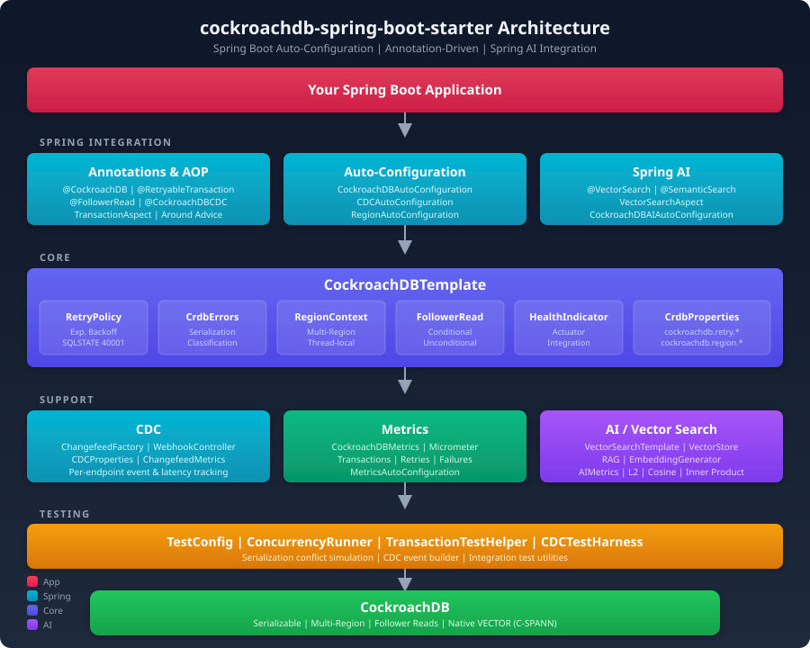

# CockroachDB Spring Boot Starter

[](https://github.com/cockroachlabs/cockroachdb-spring-boot-starter/actions/workflows/ci.yml)
[](https://github.com/cockroachlabs/cockroachdb-spring-boot-starter/releases)
[](LICENSE)

A Spring Boot starter that provides automatic retry handling for CockroachDB serialization errors (SQLSTATE `40001`), built-in transaction metrics, multi-region support for REGIONAL BY ROW tables, concurrency testing utilities, and Spring AI `VectorStore` integration for RAG pipelines.

Designed for Spring Boot 4.x and Java 21+. **GraalVM Native Image ready.**

## Architecture



## Features

- **`@CockroachDB` annotation** — Declarative retry with exponential backoff for serialization conflicts
- **`CockroachDBTemplate`** — Programmatic API for transactional operations with retry
- **Multi-region support** — `RegionContext`, `RegionResolver`, `inRegion()` for REGIONAL BY ROW tables
- **JPA annotations** — `@RegionalByRow`, `@CrdbRegion`, `@GlobalTable` for entity-level region handling
- **Micrometer metrics** — Transaction count, retries, failures, and duration (auto-enabled with Actuator)
- **Concurrency runner** — `CockroachDBConcurrencyRunner` for stress-testing serialization behavior
- **CDC webhook handlers** — `@CockroachDBCDC` annotation for consuming CockroachDB changefeeds via HTTP webhook sink
- **CDC test harness** — `CDCTestHarness` and `CDCEventBuilder` for integration testing without a live changefeed
- **CDC metrics** — Per-endpoint event counts, latency, and auth failure tracking (auto-enabled with Actuator)
- **Follower reads** — `@FollowerRead` annotation for low-latency reads from any replica with conditional or unconditional staleness
- **Vector search** — `@VectorSearch` annotation for pgvector-compatible similarity search (L2, cosine, inner product) with CockroachDB's C-SPANN distributed vector indexing
- **Semantic search** — `@SemanticSearch` annotation for RAG-style queries combining vector similarity with structured SQL filters in a single transaction
- **`VectorSearchTemplate`** — Programmatic API for embedding storage, similarity search, and hybrid queries (vector + relational filters)
- **Spring AI `VectorStore`** — `CockroachDBVectorStore` implementing Spring AI's `VectorStore` for seamless RAG with `ChatClient` and `QuestionAnswerAdvisor`
- **AI metrics** — Vector search count, latency, and result-set tracking (auto-enabled with Actuator)

## Installation

### Gradle

```groovy
dependencies {
    implementation 'com.cockroachlabs:cockroachdb-spring-boot-starter:0.1.0-SNAPSHOT'
}
```

### Maven

```xml
<dependency>
    <groupId>com.cockroachlabs</groupId>
    <artifactId>cockroachdb-spring-boot-starter</artifactId>
    <version>0.1.0-SNAPSHOT</version>
</dependency>
```

## Configuration

Add to `application.yml`:

```yaml
cockroachdb:
  retry:
    max-retries: 3        # Max retry attempts for 40001 errors
    delay: 100            # Initial delay in ms
    multiplier: 2.0       # Exponential backoff multiplier
    max-delay: 5000       # Max delay cap in ms
    jitter: 50            # Randomized jitter in ms
  region:
    default: ""           # Default region (empty = gateway region)
    validate: false       # Validate against allowed list
    allowed: []           # Allowed regions (empty = allow any)
    resolver: context     # Strategy: static | header | context | bean
    header-name: X-CockroachDB-Region
  metrics:
    enabled: true         # Enable transaction metrics
```

## Usage

### 1. `@CockroachDB` Annotation

Wrap any method with `@CockroachDB` to get automatic retry on serialization errors. Each retry runs in a **fresh transaction**.

```java
@Service
public class AccountService {

    @Autowired
    private AccountRepository accountRepo;

    @CockroachDB
    public void transfer(UUID from, UUID to, BigDecimal amount) {
        Account sender = accountRepo.findById(from).orElseThrow();
        Account receiver = accountRepo.findById(to).orElseThrow();
        sender.debit(amount);
        receiver.credit(amount);
        accountRepo.saveAll(List.of(sender, receiver));
    }

    // Override retry settings per method
    @CockroachDB(maxRetries = 10, delay = 50, readOnly = true)
    public BigDecimal totalBalance() {
        return accountRepo.sumAllBalances();
    }
}
```

### 2. `CockroachDBTemplate`

For programmatic control, inject `CockroachDBTemplate`:

```java
@Service
public class AccountService {

    @Autowired
    private CockroachDBTemplate crdbTemplate;

    @Autowired
    private AccountRepository accountRepo;

    public void transfer(UUID from, UUID to, BigDecimal amount) {
        crdbTemplate.execute(() -> {
            Account sender = accountRepo.findById(from).orElseThrow();
            Account receiver = accountRepo.findById(to).orElseThrow();
            sender.debit(amount);
            receiver.credit(amount);
            accountRepo.saveAll(List.of(sender, receiver));
            return null;
        });
    }

    public BigDecimal totalBalance() {
        return crdbTemplate.executeReadCommitted(() ->
            accountRepo.sumAllBalances()
        );
    }
}
```

### 3. Multi-Region Support

#### Set region via `@CockroachDB` annotation

```java
@CockroachDB(region = "us-east1")
public void createOrderEast(Order order) {
    orderRepo.save(order);
}
```

#### Set region programmatically with `inRegion()`

```java
public void createOrder(String region, Order order) {
    crdbTemplate.inRegion(region).execute(() -> {
        orderRepo.save(order);
        return null;
    });
}
```

#### Set region per-request with `RegionContext`

```java
// In a filter, interceptor, or manually:
RegionContext.set("eu-west1");

// All @CockroachDB and crdbTemplate calls in this thread
// will use eu-west1 until cleared.

// Scoped (auto-cleanup):
try (var scope = RegionContext.scoped("eu-west1")) {
    crdbTemplate.execute(() -> orderRepo.save(order));
}
```

#### Auto-detect region from HTTP headers

Configure the header-based resolver:

```yaml
cockroachdb:
  region:
    resolver: header
    header-name: X-CockroachDB-Region
```

Then clients send:

```
POST /api/orders
X-CockroachDB-Region: us-west1
```

#### Custom `RegionResolver`

Implement your own strategy (GeoIP, config service, etc.):

```java
@Bean
public RegionResolver regionResolver(GeoIPService geoIP) {
    return () -> {
        HttpServletRequest req = ((ServletRequestAttributes)
            RequestContextHolder.getRequestAttributes()).getRequest();
        return geoIP.regionForIp(req.getRemoteAddr());
    };
}
```

Set `resolver: bean` in config so the starter doesn't override your bean.

#### Region resolution priority

When multiple sources provide a region, the highest-priority source wins:

| Priority | Source | Example |
|----------|--------|---------|
| 1 | `@CockroachDB(region = "...")` | Explicit per-method |
| 2 | `RegionContext.current()` | ThreadLocal (filter, scoped) |
| 3 | `RegionResolver` bean | Header, GeoIP, custom |
| 4 | `cockroachdb.region.default` | `application.yml` |
| 5 | *(empty)* | CockroachDB uses gateway node's region |

### 4. JPA Entity Annotations

For REGIONAL BY ROW tables, annotate entities so the `crdb_region` field is auto-populated from `RegionContext`:

```java
@Entity
@Table(name = "orders")
@RegionalByRow(defaultRegion = "us-east1")
@EntityListeners(RegionalByRowListener.class)
public class Order {

    @Id
    @GeneratedValue
    private UUID id;

    @CrdbRegion
    @Column(name = "crdb_region", columnDefinition = "crdb_internal_region")
    private String region;

    private String customerName;
    private BigDecimal total;
}
```

The `@PrePersist` listener sets the region from `RegionContext` (or the `defaultRegion`) if the field is null on save.

For GLOBAL tables, use the marker annotation for documentation:

```java
@Entity
@Table(name = "currencies")
@GlobalTable
public class Currency {
    @Id
    private String code;
    private String name;
}
```

> **Note:** The starter does not manage DDL. Create your REGIONAL BY ROW and GLOBAL tables via Flyway or Liquibase.

### 5. Metrics

When Spring Boot Actuator is on the classpath, the starter auto-registers Micrometer metrics:

| Metric | Type | Description |
|--------|------|-------------|
| `cockroachdb.transactions` | Counter | Total transactions attempted |
| `cockroachdb.transactions.success` | Counter | Successful transactions |
| `cockroachdb.transactions.failure` | Counter | Failed transactions |
| `cockroachdb.transactions.retries` | Counter | Retry attempts (40001) |
| `cockroachdb.transactions.duration` | Timer | Transaction duration |

Without Actuator, an in-memory fallback tracks the same counters (accessible via `CockroachDBMetrics` bean).

Expose via Prometheus:

```yaml
# build.gradle
runtimeOnly 'io.micrometer:micrometer-registry-prometheus'

# application.yml
management:
  endpoints:
    web:
      exposure:
        include: prometheus
```

### 6. Concurrency Testing

Use `CockroachDBConcurrencyRunner` to stress-test serialization behavior:

```java
@SpringBootTest
class TransferConcurrencyTest {

    @Autowired
    private AccountService accountService;

    @Test
    void concurrentTransfers() {
        CockroachDBConcurrencyRunner.Result result =
            CockroachDBConcurrencyRunner.run(
                10,    // threads
                100,   // iterations per thread
                () -> accountService.transfer(
                    accountA, accountB, BigDecimal.ONE)
            );

        System.out.println("Ops/sec: " + result.opsPerSecond());
        System.out.println("Successes: " + result.successes());
        System.out.println("Failures: " + result.failures());
        assertEquals(0, result.failures());
    }
}
```

### 7. CDC Webhook Handlers

CockroachDB [changefeeds](https://www.cockroachlabs.com/docs/stable/changefeed-sinks.html#webhook-sink) can push row-level changes to your application via HTTP webhook sink. The starter turns any Spring bean method into a CDC handler with the `@CockroachDBCDC` annotation.

#### Enable CDC

```yaml
cockroachdb:
  cdc:
    enabled: true
    base-path: /cdc          # Prefix for all webhook endpoints (default: /cdc)
    auth-token: ""            # If set, webhook requests must include this token
    auth-header: Authorization  # Header name for the token (default: Authorization)
    factory:
      enabled: true           # Auto-register CockroachDBCDCFactory bean (requires spring-jdbc)
```

#### Define a handler

Annotate a method with `@CockroachDBCDC` and declare the endpoint path. The method receives a `CDCEvent<T>` where `T` is your entity/DTO type:

```java
@Component
public class OrderCDCListener {

    @CockroachDBCDC(endpoint = "/orders")
    public void onOrderChange(CDCEvent<Order> event) {
        switch (event.operation()) {
            case INSERT -> handleNewOrder(event.after());
            case UPDATE -> handleOrderUpdate(event.before(), event.after());
            case DELETE -> handleOrderCancelled(event.key());
        }
    }

    // Filter by operation type and specify column projections
    @CockroachDBCDC(
        endpoint = "/orders/status",
        operations = CDCOperationType.UPDATE,
        projections = {"id", "status"}
    )
    public void onStatusChange(CDCEvent<OrderStatus> event) {
        log.info("Order {} status: {} -> {}",
                event.after().id(), event.before().status(), event.after().status());
    }
}
```

The handler is registered at `{basePath}{endpoint}` — e.g., `/cdc/orders`. Configure your CockroachDB changefeed to push to that URL:

```sql
CREATE CHANGEFEED FOR TABLE orders
  INTO 'webhook-https://your-app:9090/cdc/orders?insecure_tls_skip_verify=true'
  WITH updated, diff, resolved = '10s',
       webhook_sink_config = '{"Flush": {"Messages": 100, "Frequency": "1s"}}';
```

#### Handler signature options

| Parameter type | Behavior |
|---------------|----------|
| `CDCEvent<T>` | Called once per row change with typed before/after, key, operation, timestamp |
| `List<CDCEvent<T>>` | Called once per batch with all events in the webhook payload |
| `CDCEnvelope` | Raw envelope — for custom parsing or forwarding |
| `T` (entity) | Called with just the `after` entity (simplified handler) |

#### CDC metrics

When Actuator is on the classpath, the starter tracks per-endpoint CDC metrics:

| Metric | Type | Tags | Description |
|--------|------|------|-------------|
| `cockroachdb.cdc.events` | Counter | endpoint, operation, success | Events processed |
| `cockroachdb.cdc.events.duration` | Timer | endpoint, operation | Processing latency |
| `cockroachdb.cdc.webhooks.received` | Counter | endpoint | Raw webhook requests received |
| `cockroachdb.cdc.auth.failures` | Counter | endpoint | Authentication failures |
| `cockroachdb.cdc.resolved` | Counter | endpoint | Resolved timestamp markers |

#### Testing CDC handlers

Use `CDCTestHarness` to invoke handlers directly without HTTP or a live changefeed:

```java
@SpringBootTest
class OrderCDCTest {

    @Autowired
    private CDCTestHarness cdcTestHarness;

    @Autowired
    private OrderCDCListener listener;

    @Test
    void shouldHandleInsert() {
        Order order = new Order(UUID.randomUUID(), "PENDING", BigDecimal.TEN);
        cdcTestHarness.simulateInsert("/orders", order, order.getId());

        // Assert side effects in listener
    }

    @Test
    void shouldHandleUpdate() {
        Order before = new Order(id, "PENDING", BigDecimal.TEN);
        Order after = new Order(id, "SHIPPED", BigDecimal.TEN);
        cdcTestHarness.simulateUpdate("/orders", before, after, id);
    }

    @Test
    void shouldHandleDelete() {
        cdcTestHarness.simulateDelete("/orders", orderId);
    }
}
```

For fine-grained control, use `CDCEventBuilder`:

```java
CDCEvent<Order> event = CDCEventBuilder.<Order>create()
        .operation(CDCOperationType.UPDATE)
        .before(oldOrder)
        .after(newOrder)
        .key(orderId)
        .table("orders")
        .timestamp(Instant.now())
        .build();

cdcTestHarness.send("/orders", event);
```

### 8. Follower Reads

CockroachDB's [follower reads](https://www.cockroachlabs.com/docs/stable/follower-reads.html) allow any replica to serve reads at a slightly stale timestamp (`~4.8s`), avoiding the round-trip to the leaseholder. The `@FollowerRead` annotation wraps a method in a read-only transaction with `SET TRANSACTION AS OF SYSTEM TIME follower_read_timestamp()`.

#### Conditional follower reads (default)

The annotation inspects a boolean parameter to decide at runtime:

```java
@Service
public class CatalogService {

    @FollowerRead
    public List<Product> findAll(boolean stale) {
        return productRepo.findAll();
    }

    @FollowerRead
    public Product findById(UUID id, boolean stale) {
        return productRepo.findById(id).orElseThrow();
    }
}
```

When `stale=true`, the method runs in a follower-read transaction. When `stale=false`, the method runs normally against the leaseholder. The parameter name defaults to `"stale"` but is configurable:

```java
@FollowerRead(staleParam = "useReplica")
public List<Product> findAll(boolean useReplica) {
    return productRepo.findAll();
}
```

#### Unconditional follower reads

Set `staleParam = ""` to always use follower reads — no boolean parameter needed:

```java
@FollowerRead(staleParam = "")
public List<Product> browseCatalog() {
    return productRepo.findAll();
}
```

#### When to use follower reads

| Use case | Follower read? |
|----------|---------------|
| Product browsing, search results | Yes — slight staleness is imperceptible |
| Dashboards, aggregate metrics | Yes — a few seconds lag is fine |
| Checkout, payment | No — must see real-time inventory |
| Authentication, permissions | No — must see latest credentials |

#### Follower read metrics

When Actuator is on the classpath, the starter tracks:

| Metric | Type | Description |
|--------|------|-------------|
| `cockroachdb.follower.reads` | Counter | Total follower reads executed |

### 9. Vector Search (AI / RAG)

CockroachDB [v24.2+](https://www.cockroachlabs.com/blog/vector-search-pgvector-cockroachdb/) supports pgvector-compatible `VECTOR` columns, and [v25.2+](https://www.cockroachlabs.com/blog/distributed-vector-indexing-cockroachdb/) adds distributed vector indexing via C-SPANN. The starter provides annotations and a template for building AI-powered search, RAG pipelines, and agentic applications directly on CockroachDB — no separate vector database needed.

#### Enable AI features

```yaml
cockroachdb:
  ai:
    enabled: true
    vector-search:
      default-metric: COSINE       # COSINE | L2 | INNER_PRODUCT
      default-limit: 10            # Max results per search
      default-beam-size: 0         # 0 = database default (higher = more accurate, slower)
    metrics:
      enabled: true                # Track vector search metrics with Actuator
```

#### `@VectorSearch` annotation

Annotate a method to run a similarity search against a table with a vector column. The method must accept a `float[]` parameter (the query embedding):

```java
@Service
public class ProductSearchService {

    @VectorSearch(
        table = "products",
        vectorColumn = "embedding",
        metric = DistanceMetric.COSINE,
        limit = 5
    )
    public List<VectorSearchResult<Object>> findSimilar(float[] queryVector) {
        return null; // Return value is replaced by the aspect
    }

    // With beam size for higher recall on large indexes
    @VectorSearch(
        table = "products",
        vectorColumn = "embedding",
        metric = DistanceMetric.L2,
        limit = 20,
        beamSize = 64
    )
    public List<VectorSearchResult<Object>> deepSearch(float[] queryVector) {
        return null;
    }
}
```

#### `@SemanticSearch` annotation (RAG)

Combines vector similarity with structured SQL filters — the core of RAG pipelines. Filter by category, tenant, permissions, or any column while searching by semantic similarity:

```java
@Service
public class DocumentSearchService {

    @SemanticSearch(
        table = "documents",
        vectorColumn = "embedding",
        metric = DistanceMetric.COSINE,
        limit = 10,
        filter = "category = :category AND active = true",
        maxDistance = 0.3
    )
    public List<VectorSearchResult<Object>> searchDocs(
            float[] queryVector, String category) {
        return null;
    }

    // Multi-tenant RAG — prefix-partitioned vector index
    @SemanticSearch(
        table = "documents",
        vectorColumn = "embedding",
        limit = 5,
        filter = "tenant_id = :tenantId",
        columns = {"id", "title", "content"}
    )
    public List<VectorSearchResult<Object>> tenantSearch(
            float[] queryVector, UUID tenantId) {
        return null;
    }
}
```

#### `VectorSearchTemplate`

For programmatic control over vector operations:

```java
@Service
public class EmbeddingService {

    @Autowired
    private VectorSearchTemplate vectorTemplate;

    // Store an embedding
    public void indexDocument(UUID docId, float[] embedding) {
        vectorTemplate.storeEmbedding(
            "documents", "id", docId, "embedding", embedding);
    }

    // Store with metadata
    public void indexWithMeta(UUID docId, float[] embedding,
                              String title, String category) {
        vectorTemplate.storeEmbeddingWithMetadata(
            "documents", "id", docId, "embedding", embedding,
            Map.of("title", title, "category", category));
    }

    // Search
    public List<VectorSearchResult<Object>> search(float[] query) {
        return vectorTemplate.search(
            "documents", "embedding", query,
            DistanceMetric.COSINE, 10);
    }

    // Search with filter and beam size
    public List<VectorSearchResult<Object>> filteredSearch(
            float[] query, String category) {
        return vectorTemplate.search(
            "documents", "embedding", query,
            DistanceMetric.COSINE, 10,
            List.of("id", "title", "content"),
            "category = '" + category + "'",
            32);
    }
}
```

#### `@VectorColumn` JPA annotation

Mark entity fields that store vector embeddings:

```java
@Entity
@Table(name = "documents")
public class Document {

    @Id
    @GeneratedValue
    private UUID id;

    private String title;
    private String content;
    private String category;

    @VectorColumn(dimensions = 1536)
    @Column(name = "embedding", columnDefinition = "vector(1536)")
    private float[] embedding;
}
```

> **Note:** Create your vector-enabled tables and indexes via Flyway or Liquibase:
>
> ```sql
> CREATE TABLE documents (
>     id UUID PRIMARY KEY DEFAULT gen_random_uuid(),
>     title TEXT NOT NULL,
>     content TEXT,
>     category TEXT,
>     embedding VECTOR(1536)
> );
>
> CREATE VECTOR INDEX ON documents (embedding)
>     WITH (lists = 100);
> ```

#### Distance metrics

| Metric | Operator | Best for |
|--------|----------|----------|
| L2 (Euclidean) | `<->` | General purpose, image embeddings |
| Cosine | `<=>` | Text embeddings (OpenAI, Cohere, etc.) |
| Inner Product | `<#>` | Normalized embeddings, dot-product models |

#### AI metrics

When Actuator is on the classpath, the starter tracks:

| Metric | Type | Description |
|--------|------|-------------|
| `cockroachdb.ai.vector.searches.total` | Counter | Total vector searches |
| `cockroachdb.ai.vector.searches.success` | Counter | Successful searches |
| `cockroachdb.ai.vector.searches.failure` | Counter | Failed searches |
| `cockroachdb.ai.vector.results.total` | Counter | Total results returned |
| `cockroachdb.ai.vector.searches.duration` | Timer | Search latency |

#### When to use CockroachDB for AI

| Use case | CockroachDB advantage |
|----------|----------------------|
| RAG pipelines | Vector + relational data in one transaction — no dual writes |
| Multi-tenant AI | Prefix-partitioned vector indexes scoped per tenant |
| Agent state storage | Serializable isolation for safe concurrent agent operations |
| Semantic search | Combine similarity with SQL filters, JOINs, and permissions |
| Global AI apps | Multi-region vector search with data locality |

### 10. Spring AI VectorStore Integration

The starter provides a `CockroachDBVectorStore` that implements Spring AI's `VectorStore` interface. This lets you use CockroachDB as a drop-in vector store with Spring AI's `ChatClient`, `QuestionAnswerAdvisor` (RAG), and `EmbeddingModel` — no separate vector database needed.

Spring AI is a **compile-only** dependency: if you don't use Spring AI, the module adds zero overhead.

#### Enable Spring AI integration

Add Spring AI to your project alongside the starter:

```groovy
// build.gradle
dependencyManagement {
    imports {
        mavenBom "org.springframework.ai:spring-ai-bom:2.0.0-SNAPSHOT"
    }
}

dependencies {
    implementation 'com.cockroachlabs:cockroachdb-spring-boot-starter:0.1.0-SNAPSHOT'
    implementation 'org.springframework.ai:spring-ai-starter-model-ollama'  // or openai, etc.
    implementation 'org.springframework.ai:spring-ai-advisors-vector-store' // for RAG
}
```

Configure in `application.yml`:

```yaml
cockroachdb:
  ai:
    enabled: true
    spring-ai:
      initialize-schema: true       # Auto-create vector_store table
      dimensions: 0                  # 0 = auto-detect from EmbeddingModel
      distance-type: COSINE          # COSINE | L2 | INNER_PRODUCT
      table-name: vector_store       # Table name for documents
      beam-size: 0                   # 0 = CockroachDB default C-SPANN beam size
```

#### Using `CockroachDBVectorStore`

Once configured, inject `VectorStore` anywhere in your application:

```java
@Service
public class DocumentService {

    @Autowired
    private VectorStore vectorStore;

    // Store documents (auto-embedded via Spring AI EmbeddingModel)
    public void addDocuments(List<Document> docs) {
        vectorStore.add(docs);
    }

    // Similarity search
    public List<Document> search(String query) {
        return vectorStore.similaritySearch(
            SearchRequest.builder()
                .query(query)
                .topK(5)
                .similarityThreshold(0.3)
                .build()
        );
    }

    // Filtered search via JSONB metadata
    public List<Document> searchByCategory(String query, String category) {
        return vectorStore.similaritySearch(
            SearchRequest.builder()
                .query(query)
                .topK(5)
                .filterExpression("category == '" + category + "'")
                .build()
        );
    }
}
```

#### Building a RAG chat with Spring AI

Wire `CockroachDBVectorStore` into a `ChatClient` for retrieval-augmented generation:

```java
@Service
public class ChatService {

    private final ChatClient chatClient;

    public ChatService(ChatModel chatModel, VectorStore vectorStore) {
        this.chatClient = ChatClient.builder(chatModel)
            .defaultAdvisors(
                QuestionAnswerAdvisor.builder(vectorStore)
                    .searchRequest(SearchRequest.builder()
                        .similarityThreshold(0.3)
                        .topK(4)
                        .build())
                    .build(),
                MessageChatMemoryAdvisor.builder(
                    MessageWindowChatMemory.builder()
                        .chatMemoryRepository(new InMemoryChatMemoryRepository())
                        .maxMessages(20)
                        .build()
                ).build()
            )
            .build();
    }

    public String chat(String message) {
        return chatClient.prompt()
            .user(message)
            .call()
            .content();
    }
}
```

#### Spring AI features summary

| Feature | Description |
|---------|-------------|
| `CockroachDBVectorStore` | Implements `VectorStore` with C-SPANN distributed vector indexing |
| Filter expression converter | Translates Spring AI `Filter.Expression` to JSONB SQL queries |
| Auto-configuration | Wires `VectorStore` bean when Spring AI classes are on the classpath |
| Schema initialization | Optionally creates the `vector_store` table + vector index on startup |
| Distance-to-similarity | Converts CockroachDB distance scores to Spring AI similarity [0,1] |
| AI metrics integration | Records search operations via the starter's `AIMetrics` |

### 11. Computed Columns

Mark entity fields as CockroachDB computed (generated) columns:

```java
@Entity
public class Order {
    @Id
    private UUID id;
    private Integer price;
    private Integer quantity;

    @ComputedColumn(expression = "price * quantity")
    @Column(insertable = false, updatable = false)
    private Integer total;
}
```

Generate DDL programmatically:

```java
List<String> ddl = ComputedColumnHelper.generateDDL("orders", Order.class);
// → ALTER TABLE orders ADD COLUMN IF NOT EXISTS total INT8 AS (price * quantity) STORED
```

Validate at startup:

```java
ComputedColumnHelper.validate(Order.class);
// Throws IllegalArgumentException if any @ComputedColumn has stored=false
```

> **Note:** CockroachDB requires computed columns to be `stored`. Setting `stored = false` will throw at validation time.

## Cockroach Continuum

The starter surfaces the Cockroach Continuum capabilities as ordinary Spring beans and annotations. Everything is auto-configured. Aegis is **simulated by default** (no external service needed) and feature-flagged via `cockroachdb.continuum.*`.

### vCluster — workload isolation

Tag a method's work for a virtual cluster and assign a workload priority. The starter applies `SET LOCAL application_name` and `SET LOCAL default_transaction_quality_of_service` (HIGH→critical, NORMAL→regular, LOW→background) to the transaction, isolating it on shared capacity.

```java
@VirtualCluster("analytics")
@Workload(Workload.Priority.LOW)
public BigDecimal nightlyReport() {
    return reportRepository.totals();
}
```

Programmatic (no proxy):

```java
try (var scope = VirtualClusterContext.scoped("analytics", Workload.Priority.LOW)) {
    crdbTemplate.execute(() -> reportRepository.totals());
}
```

> vCluster v1 is workload **tagging / QoS**. Routing to a distinct vCluster endpoint is platform-dependent and not performed by the starter.

### Plenum — storage insights

Read-only, usage-based storage signals per table — customer-safe (`SHOW` surfaces only, never `crdb_internal`) and version-tolerant (missing signals return empty rather than failing).

```java
@Autowired StorageInsights storage;

for (TableStorage t : storage.summary()) {
    log.info("{} rows={} bytes={}", t.qualifiedName(), t.rows(), t.bytes());
}
```

### Aegis — autonomous-ops findings + exhaust

Read findings/recommendations and emit app-attributed telemetry ("exhaust"). Simulated by default; set `cockroachdb.continuum.aegis.endpoint` to target a real service once the Aegis API is available.

```java
@Autowired AegisClient aegis;
@Autowired AegisExhaust exhaust;

aegis.findings().forEach(f -> log.warn("Aegis {}: {}", f.severity(), f.title()));
exhaust.recordRetry("PayrollService.runPayroll", attempt);
```

### Agent / MCP — database ops as agent tools

Expose safe operations as agent-callable tools (MCP `tools/list` + `tools/call`), least-privilege by default. A built-in `CrdbOpsTools` (health, storage_summary) is auto-registered.

```java
@Autowired CrdbAgent agent;

List<ToolDescriptor> tools = agent.listTools();    // MCP tools/list
Object health = agent.invoke("health", Map.of());  // MCP tools/call
```

Mark your own methods with `@AgentTool("name")`; destructive tools are hidden unless `cockroachdb.continuum.agent.allow-destructive=true`.

### Cloud control plane + virtual-cluster lifecycle

A Cloud control-plane client (simulated until `cockroachdb.continuum.cloud.api-key` is set), typed metric-export builders, a virtual-cluster lifecycle manager, plus an actuator endpoint and health indicator.

```java
@Autowired CloudClient cloud;   // SimulatedCloudClient until an API key is configured

cloud.listClusters();
cloud.configureMetricExport(clusterId, MetricExport.datadog(ddKey, "US1")); // datadog/cloudWatch/prometheus

// Virtual clusters over a JdbcTemplate:
var vm = new VirtualClusterManager(jdbcTemplate);
vm.create("analytics");
String dsn = VirtualClusterManager.routingConnString(baseUrl, "analytics"); // adds -ccluster option
```

The `continuum` actuator endpoint (`GET /actuator/continuum`) and a health contributor (`ContinuumCloudHealthIndicator`, surfaced in `/actuator/health`) report Cloud reachability.

### MCP client + Aegis over MCP

MCP is a public, versioned protocol, so the client speaks the real wire format (2025-06-18 initialize handshake, `tools/list`, `tools/call`, SSE + session handling). The Aegis REST API is not yet public, so Aegis is reached read-only **over MCP** with caller-supplied tool names (discover them via `listTools()`) rather than an invented wire protocol.

```java
McpClient mcp = ContinuumMcpFactory.create(
        new McpClient.Config(true, "https://cockroachlabs.cloud/mcp", token));
mcp.listTools();
var aegisOverMcp = new McpAegisClient(mcp,
        new McpAegisClient.ToolNames("list_findings", "list_recommendations", "emit_event"));
aegisOverMcp.findings();
```

### Continuum properties

| Property | Default | Description |
|----------|---------|-------------|
| `cockroachdb.continuum.aegis.enabled` | `true` | Expose an `AegisClient` bean |
| `cockroachdb.continuum.aegis.endpoint` | (blank) | Blank → `SimulatedAegisClient`; set → real HTTP client |
| `cockroachdb.continuum.aegis.token` | (blank) | Bearer token for the real Aegis endpoint |
| `cockroachdb.continuum.agent.enabled` | `true` | Expose `CrdbAgent` + built-in ops tools |
| `cockroachdb.continuum.agent.allow-destructive` | `false` | Include destructive `@AgentTool`s |
| `cockroachdb.continuum.cloud.enabled` | `true` | Expose a `CloudClient` bean |
| `cockroachdb.continuum.cloud.api-key` | (blank) | Blank → `SimulatedCloudClient`; set → real HTTP client (Bearer) |
| `cockroachdb.continuum.cloud.base-url` | (blank) | Blank → `https://cockroachlabs.cloud/api/v1` |

## GraalVM Native Image

The starter is **native-ready** out of the box. All annotations, AOP aspects, CDC DTOs, and configuration properties are registered for GraalVM reflection via `CockroachDBRuntimeHints`.

### Building a native image

Add the GraalVM native plugin to your app's `build.gradle`:

```groovy
plugins {
    id 'org.graalvm.buildtools.native' version '0.10.6'
}
```

Build and run:

```bash
./gradlew nativeCompile
./build/native/nativeCompile/your-app
```

### What's registered for native

The starter auto-registers hints for:
- **Annotations**: `@CockroachDB`, `@FollowerRead`, `@RegionalByRow`, `@GlobalTable`, `@CrdbRegion`, `@ComputedColumn`, `@CockroachDBCDC`, `@VectorSearch`, `@SemanticSearch`, `@VectorColumn`
- **AOP aspects**: `CockroachDBAspect`, `FollowerReadAspect`, `VectorSearchAspect`, `SemanticSearchAspect`
- **CDC DTOs**: `CDCEnvelope`, `CDCEvent`, `CDCPayload`, `CDCOperationType`
- **Services**: `CockroachDBTemplate`, `CockroachDBMetrics`, `VectorSearchTemplate`, `ComputedColumnHelper`
- **Proxies**: `RegionResolver`, `CockroachDBMetrics`, `CDCMetrics`, `AIMetrics`
- **Properties**: `CockroachDBProperties` and nested classes

### App-side hints

If your app has entities or DTOs that need native reflection (e.g., JPA entities, CDC change records), add your own `RuntimeHintsRegistrar`:

```java
public class MyAppRuntimeHints implements RuntimeHintsRegistrar {
    @Override
    public void registerHints(RuntimeHints hints, ClassLoader classLoader) {
        hints.reflection().registerType(MyEntity.class, MemberCategory.values());
    }
}

@SpringBootApplication
@ImportRuntimeHints(MyAppRuntimeHints.class)
public class MyApplication { ... }
```

## How It Works

The `@CockroachDB` aspect runs at `@Order(LOWEST_PRECEDENCE - 2)` — **outside** the Spring transaction advisor. This means each retry attempt creates a fresh transaction, which is required for CockroachDB serialization retries (you cannot retry within the same transaction).

```
@CockroachDB aspect (retry loop)
  └─ TransactionTemplate.execute() (new tx per attempt)
       └─ SET crdb_region = '...'  (if multi-region)
            └─ Your method body
```

On a `40001` SQLSTATE error, the aspect:
1. Rolls back the failed transaction
2. Waits with exponential backoff + jitter
3. Opens a new transaction and retries
4. Records metrics (retries, duration, success/failure)

## License

Apache License 2.0
